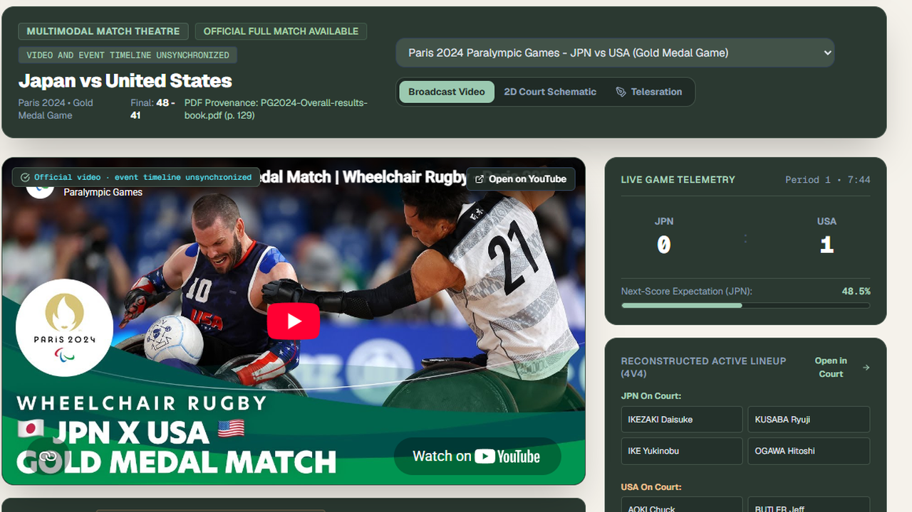
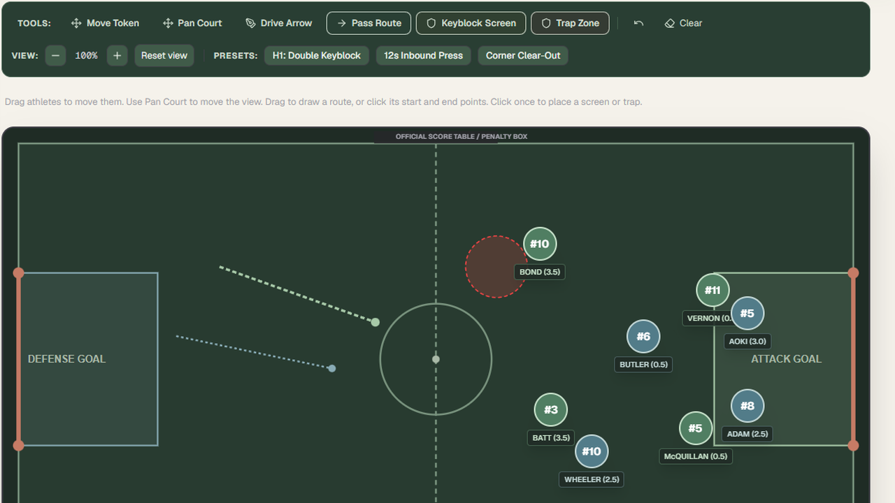
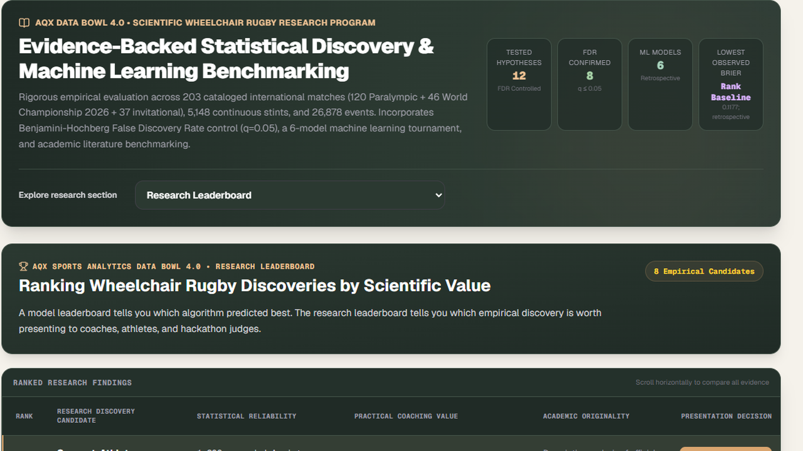
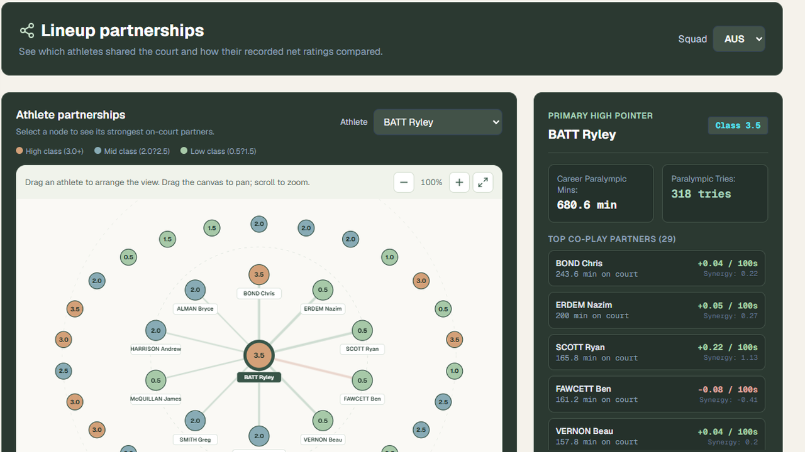
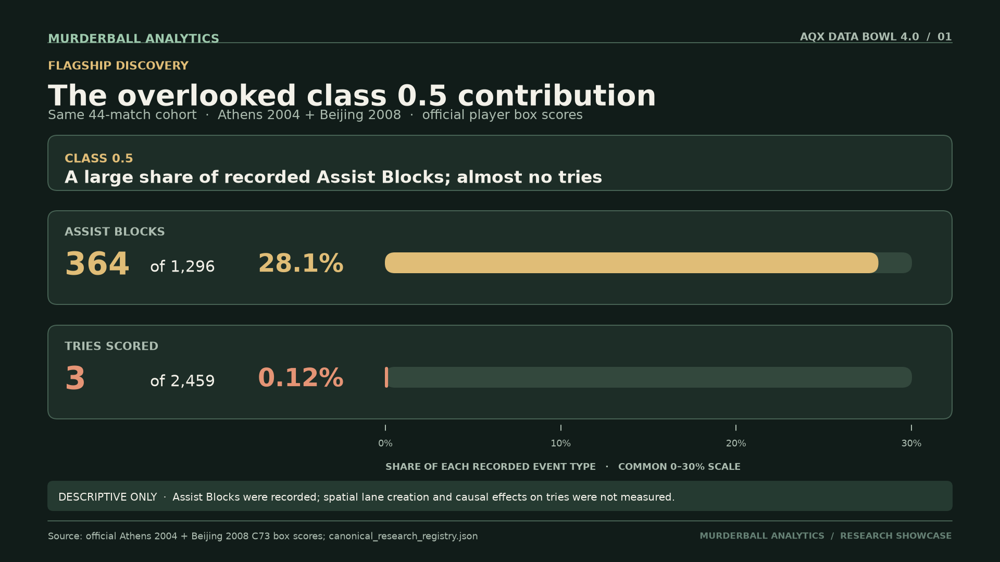
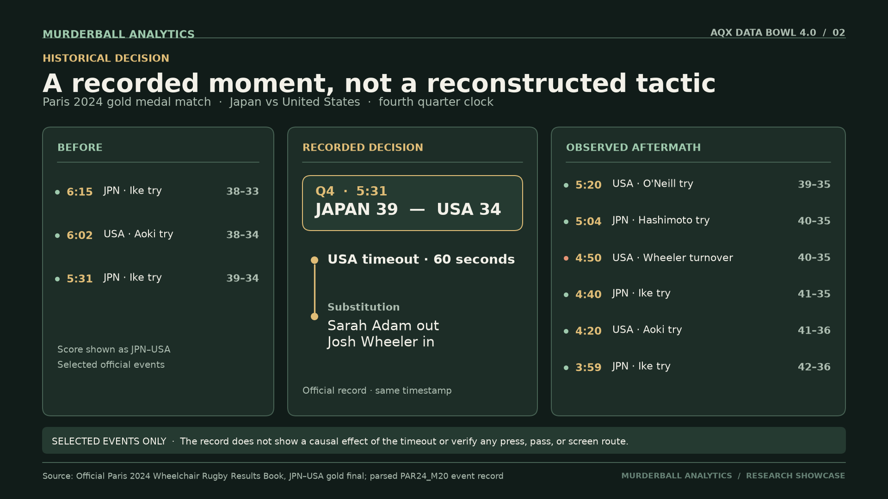
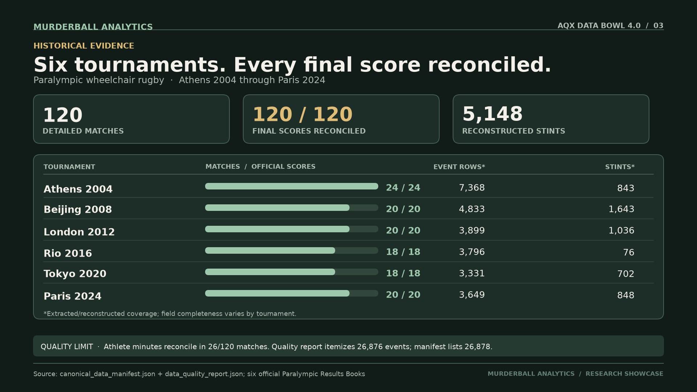
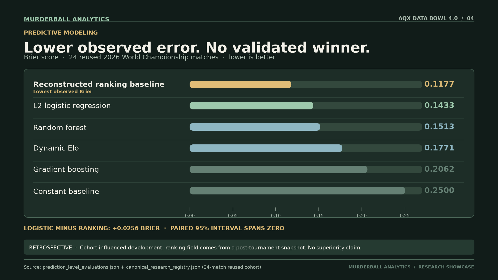
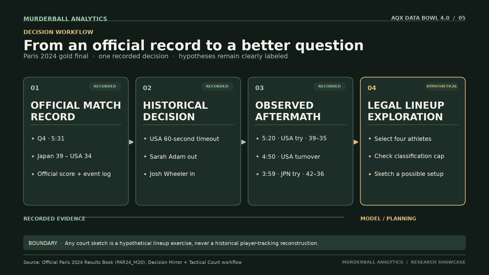

# Murderball Analytics

**Wheelchair rugby, from the scoreline to the evidence behind it.** Built for the AQX Sports Analytics Data Bowl 4.0.

[Live website](https://murderball.vercel.app/) · [GitHub source](https://github.com/ZENODIUM/Murderball-Analytics) · [Research figures](Docs/presentation_assets/README.md) · [Technical evidence](Docs/SUBMISSION_TECHNICAL_APPENDIX.md)

**Recorded demo:** `[add URL before submission]`

## Why I built it

Wheelchair rugby is a fast, physical Paralympic team sport nicknamed *Murderball*. Four athletes play at a time, and their sport classifications determine which combinations fit the lineup's point limit. A scoreboard tells you who crossed the goal line. It says much less about supporting work, the lineup on court, or what a coach could learn from an important decision.

Murderball Analytics connects official match records with tools for exploring those questions. Coaches and analysts can move from a historical game to its recorded events and lineups, then examine legal alternatives on an interactive court. Fans and athletes can see contributions that try totals alone may miss. The app keeps recorded history separate from model estimates and tactical ideas.

## The finding that changed how I looked at the box score

In **44 matches** from the official [Athens 2004](https://worldwheelchair.rugby/wp-content/uploads/2021/08/2004_Athens_Wheelchair_Rugby_Results_Book.pdf) and [Beijing 2008](https://worldwheelchair.rugby/wp-content/uploads/2021/08/2008_Beijing_Wheelchair_Rugby_Results_Book.pdf) results books, class **0.5** athletes recorded **364 of 1,296 Assist Blocks (28.1%)**. They scored **3 of 2,459 tries (0.12%)** in the same box-score cohort. Those two views of contribution look very different.

An Assist Block is a recorded box-score action. These numbers show a difference in *recorded roles*; they do not show that a particular block created a scoring lane or caused a try. The practical lesson is to investigate support work before judging a player by scoring alone. [See the figure and its source notes](Docs/presentation_assets/README.md#files-and-suggested-use).

## From a match moment to a coaching question

At **5:31 left in the fourth quarter** of the Paris 2024 gold medal match, Japan led the United States **39–34**. The official record shows a USA timeout and substitution. In Murderball Analytics, **Match Theatre** lets you inspect the score and recorded events around that moment. **Decision Mirror** shows what happened afterward and frames alternative lineup choices as questions. **Tactical Court** lets you arrange four athletes, check the classification limit for a selected rules era, and sketch a possible setup.

That workflow is useful because its boundary is visible: a court sketch is a plan, not historical player tracking; a modeled alternative is not evidence that a different decision would have changed the result. Broadcast footage is labeled when its timing has not been synchronized to the event log.

## Explore the platform

The application has two main tabs: **Workspace** for match and coaching tools, and **Research & Data** for findings and source checks. These are implemented views; data depth varies, and some live or write actions need the local API.

### Workspace — match and coaching tools

| View | What it does |
| --- | --- |
| **Match Theatre** | Plays through recorded scores, events, and lineups; shows available broadcast footage with an explicit synchronization warning and links decisions to other tools. |
| **Match Explorer** | Searches detailed matches and opens box scores, period results, reconstructed stints, and play-by-play. |
| **Player Studio** | Searches athlete dossiers and compares classifications, box-score contributions, and model-based impact estimates. |
| **Championships** | Browses tournament editions, medal results, standings, and linked matches. |
| **World Rankings** | Explores the dated 2026 WWR snapshot and its documented source anomalies; it is not a live ranking feed. |
| **Tactical Court** | Moves four-on-four athlete tokens, checks era-specific lineup points, pans and zooms, draws ideas, and saves scenarios in the browser. |
| **Lineup Optimizer** | Searches legal four-athlete combinations under a chosen roster, objective, and classification limit. |
| **Scenario Lab** | Simulates possible match continuations and displays an outcome distribution rather than a guaranteed result. |
| **Coach Assistant** | Routes questions toward coaching and research evidence, with citations and an execution trace where available. |
| **Decision Mirror** | Places a recorded coaching moment beside its observed aftermath and clearly labeled hypothetical lineup options. |
| **Pressure Atlas** | Maps score and period states to observed next-score and turnover patterns, with sample counts. |
| **Lineup Constellation** | Lets users drag and inspect a focused co-play network of athletes, shared minutes, and model-based partnership summaries. |
| **Confidence Frontier** | Compares lineup estimates with their supporting evidence and uncertainty, then sends a selected unit to the court. |
| **RuleShift Lab** | Tests how a lineup's legality and modeled options change under different historical classification rules. |
| **Archetypes** | Groups player profiles by analytic role patterns and opens the athletes behind each group. |

### Research & Data — findings and validation

| View | What it does |
| --- | --- |
| **Overview** | Summarizes headline findings, archive coverage, rankings context, and routes into deeper evidence. |
| **Research Hub** | Houses the research leaderboard, historical cases, 12-hypothesis portfolio, six-model comparison, coaching playbook, literature context, core dossiers, prior AQX benchmarks, and co-play analysis. |
| **Living Intelligence** | Shows retrospective prediction review, model registry, drift, future-event plans, source discovery, and a backend-dependent forecast/audit workflow. |
| **Frontier Lab** | Explores user cases, misleading statistics, possession-risk models, lineup interactions, change points, and simulated match paths. |
| **Data Coverage** | Maps venues and coverage tiers; includes the athlete registry, rules-and-legality tester, model-expansion comparison, and source audit. |
| **Data Quality** | Reports extraction and reconciliation by tournament, including final scores, athlete-minute coverage, and source documents. |
| **CV Evaluation** | Presents a limited computer-vision pilot and its failure modes; it is not full-match player tracking. |
| **Annotation Queue** | Prioritizes clips and evidence gaps for future human review; a queued task is not a completed annotation. |

The shared **Guided tour** walks through key views and opens the relevant tools without creating a separate source of evidence.

### AI-assisted coaching and Jev

The **Coach Assistant** routes a question to match, lineup, scouting, or research tools, then shows its citations, evidence gaps, and execution trace. The backend's **TypeSafe Jev adapter** provides typed *Choice*, *Noul*, and *Score* operations for intent routing, ambiguity checks, and evidence grading. The current implementation runs those operations **deterministically offline**. It recognizes a server-side `TYPESAFE_API_KEY`, but does not yet send requests to the live Jev API; adding a key alone does not activate remote Jev decisions. No key is required for the published prototype, and no secret belongs in this repository. Jev-style scores are not match-win probabilities or proof that a tactic works.

### Application gallery

<table>
  <tr>
    <td align="center" width="50%"><a href="Docs/screenshots/github/match_theatre.png"></a><br><sub>Match Theatre · recorded events and broadcast status</sub></td>
    <td align="center" width="50%"><a href="Docs/screenshots/github/tactical_court.png"></a><br><sub>Tactical Court · hypothetical lineup planning</sub></td>
  </tr>
  <tr>
    <td align="center"><a href="Docs/screenshots/github/research_hub.png"></a><br><sub>Research Hub · findings and limitations</sub></td>
    <td align="center"><a href="Docs/screenshots/github/lineup_constellation.png"></a><br><sub>Lineup Constellation · interactive co-play network</sub></td>
  </tr>
</table>

### Presentation figures

The [five figure package](Docs/presentation_assets/README.md) covers overlooked player contributions, the Paris decision, data coverage, the retrospective model comparison, and the evidence-to-coaching workflow. Each figure has slide-sized PNG, SVG, and light-background exports.

<table>
  <tr>
    <td align="center" width="50%"><a href="Docs/presentation_assets/01_assist_block_discovery.png"></a><br><sub>1 · Assist Block discovery</sub></td>
    <td align="center" width="50%"><a href="Docs/presentation_assets/02_paris_decision_timeline.png"></a><br><sub>2 · Paris decision timeline</sub></td>
  </tr>
  <tr>
    <td align="center"><a href="Docs/presentation_assets/03_historical_coverage.png"></a><br><sub>3 · Historical coverage</sub></td>
    <td align="center"><a href="Docs/presentation_assets/04_model_comparison.png"></a><br><sub>4 · Model comparison</sub></td>
  </tr>
  <tr>
    <td align="center" colspan="2"><a href="Docs/presentation_assets/05_evidence_to_decision.png"></a><br><sub>5 · From evidence to coaching questions</sub></td>
  </tr>
</table>

[View the contact sheet](Docs/presentation_assets/contact_sheet.png) or open the [figure source notes](Docs/presentation_assets/README.md).

## Where the evidence comes from

The detailed archive covers **120 Paralympic matches across six Games, 2004–2024**. All **120 final scores** were reconciled against official results books. The platform also catalogs 2026 World Championship and invitational results, but those sources do not all have the same event and lineup detail. Reconstructed event sequences and **5,148 lineup stints** make deeper exploration possible where the records support it; athlete-minute and spatial validation have narrower coverage.

### Original data sources

| Publisher | Records used |
| --- | --- |
| [World Wheelchair Rugby results](https://worldwheelchair.rugby/results/) | Official Paralympic wheelchair-rugby results books for Athens 2004 through Paris 2024, plus historical World Championship summary books. |
| [World Wheelchair Rugby rankings](https://worldwheelchair.rugby/world-rankings/) | Dated 29 August 2026 ranking snapshot, used with its post-tournament timing disclosed. |
| [Japan Wheelchair Rugby Federation](https://jwrf.jp/national_team/2026wwrworldchampionship/) | Published 2026 World Championship results used in the championship catalog. |
| [International Paralympic Committee results](https://www.paralympic.org/paralympic-games-results) | Historical Paralympic result reference and cross-check. |

Additional invitational source URLs and acceptance decisions are recorded in the [source registry](data/extracted/data_discovery_registry.json) and [expanded match catalog](data/extracted/expanded_international_matches.json). Third-party media is referenced through the [media catalog](data/extracted/media_catalog.json); a video link is not synchronized player tracking.

The [technical appendix](Docs/SUBMISSION_TECHNICAL_APPENDIX.md) gives the cohorts, statistical results, model comparison, provenance limits, and reproduction paths. The [canonical research registry](data/extracted/canonical_research_registry.json) is the authority for headline claims.

## Research and experiments

The [research portfolio](data/extracted/statistical_discovery_audit.json) catalogs **12 questions**. Its older FDR export contains some superseded numbers and interpretations, so the table below names every experiment but gives exact findings only where they agree with the [canonical registry](data/extracted/canonical_research_registry.json). “Exploratory” means the result should generate a question, not a coaching rule. [Methods, denominators, and source limitations](Docs/SUBMISSION_TECHNICAL_APPENDIX.md) are documented separately.

| Experiment | Question or method | Current evidence-based reading |
| --- | --- | --- |
| **H01 · Assist Blocks by classification** | Compare who records Assist Blocks with who scores tries. | **364/1,296** blocks versus **3/2,459** tries for class 0.5; descriptive role difference, no measured lane creation. |
| **H02 · Adjusted plus-minus stability** | Test whether an unregularized player-rating design is ill-conditioned. | The analyzed designs are unstable; Ridge is one regularized implementation, not a unique or causal solution. |
| **H03 · Lineup interaction surplus** | Compare observed lineup ratings with additive player estimates. | Model-defined residuals are exploratory; they do not identify a physical tactic or prove “chemistry.” |
| **H04 · Classification dispersion** | Ask whether high–low point spread tracks lineup net rating. | No general high–low superiority conclusion is established; the reported linear test is sample-specific. |
| **H05 · Immediate timeout response** | Compare the next possession after an opponent scoring run. | An older unadjusted contrast is selection-confounded; it is not a causal timeout benefit. |
| **H06 · Sustained timeout response** | Compare scoring after several possessions. | The canonical adjusted analysis is inconclusive (**p = 0.66**); no automatic 3–0 timeout rule follows. |
| **H07 · Scoring-run lengths** | Compare observed runs with a simple memoryless null. | A distributional difference does not reveal whether inbounds, traps, or another mechanism caused it. |
| **H08 · Turnover follow-up** | Measure how often a turnover is followed by a quick try. | Descriptive risk analysis; timing windows and denominators in older reports need reconciliation before using a headline rate. |
| **H09 · Substitution transition** | Compare early-stint and steadier-stint turnover rates. | Exploratory association; no “always” or “never substitute” instruction is supported. |
| **H10 · Female allowance comparison** | Compare recorded net efficiency of female-inclusive and all-male stints. | Difference **−0.0078 tries/min**, **p = 0.8923**; no demonstrated parity, equivalence, or causal effect. |
| **H11 · Era and pace** | Compare scoring pace across rule eras. | Historical comparison is exploratory; an era difference alone cannot isolate a rule change's effect. |
| **H12 · Next-score prediction** | Test lineup-derived features for predicting the next try. | A modeled prediction task, not a prospectively validated coaching decision rule. |

### Six-model retrospective comparison

The models were evaluated on **24 reused 2026 World Championship matches that influenced development**. Lower Brier score means lower observed probability error.

| Model | Brier score |
| --- | ---: |
| Reconstructed-ranking baseline | **0.1177** |
| L2 logistic regression | **0.1433** |
| Random forest | **0.1513** |
| Dynamic Elo | **0.1771** |
| Gradient boosting | **0.2062** |
| Constant 50/50 baseline | **0.2500** |

The ranking baseline has the lowest *observed* error. The paired logistic-minus-baseline difference is **+0.0256**, with a **95% interval [−0.0626, +0.1139]** that spans zero; superiority is unestablished. Its ranking feature was reconstructed from a “previous rank” field in a **post-tournament** snapshot, without a separately archived pre-event snapshot. This is retrospective sensitivity analysis, not an untouched prospective test. [Full comparison and caveats](Docs/SUBMISSION_TECHNICAL_APPENDIX.md#retrospective-predictive-comparison).

### Other analytical pilots

| Pilot | What is implemented | Evidence boundary |
| --- | --- | --- |
| **Historical decision dossiers** | Decision Mirror pairs recorded match context and aftermath with modeled alternatives. | Alternatives did not occur and cannot be checked against an observed counterfactual. |
| **Lineup search and match continuation** | The optimizer searches legal combinations; Scenario Lab simulates possible continuations. | Solver results depend on the chosen objective; simulations depend on fitted assumptions. |
| **Computer vision evaluation** | CV Evaluation displays task-level pilot results and failure modes. | No validated full-match historical player tracking or spatial evidence is claimed. |
| **Frontier and prior-AQX explorations** | Frontier Lab exposes competing-risk, interaction, and change-point models; Research Hub shows previous AQX benchmarks. | These are research probes and context, not independently established tactical mechanisms. |

## Try it yourself

Open the [prototype](https://murderball.vercel.app/) and start in **Match Theatre** with the Paris final. The hosted site serves its bundled research data and browser-based exploration; some server-backed actions require a local FastAPI service.

To run the interface locally:

```powershell
cd frontend
npm install
npm run dev
```

Open `http://localhost:3000`. For local API-backed actions, install the tested [Python dependencies](requirements.txt) with `python -m pip install -r requirements.txt`, then start the service from the project root in a separate terminal with `python -m uvicorn backend.api.main:app --host 127.0.0.1 --port 8000`. The [figure package](Docs/presentation_assets/README.md) contains slide-ready visuals and its reproducible generation script.

Murderball Analytics aims to make a match easier to investigate, and the limits of the evidence just as easy to see.
